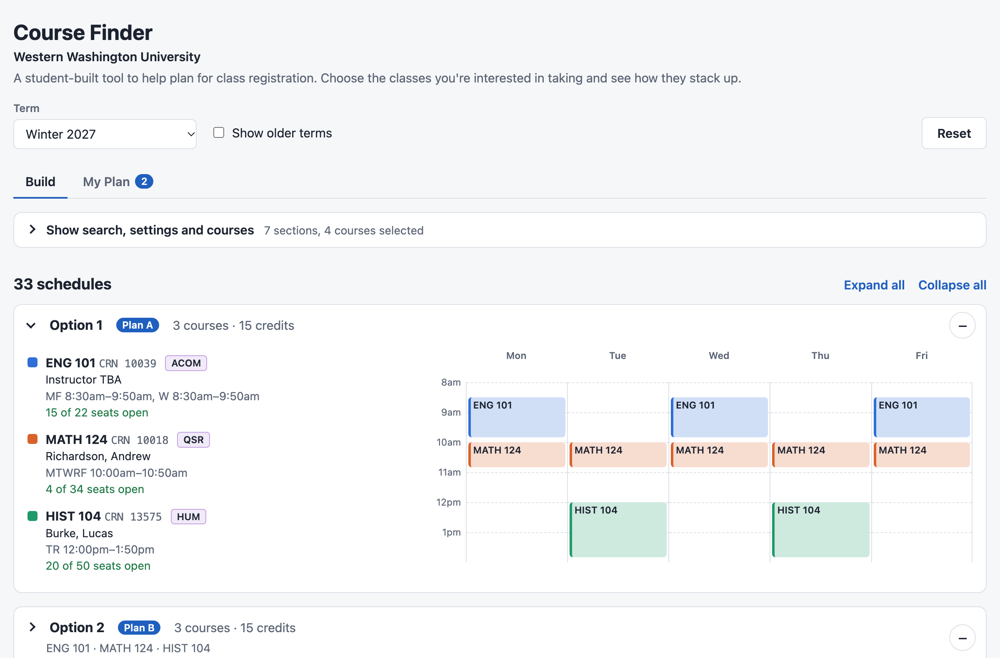

# Course Finder

A class schedule planner for Western Washington University students. Pick the sections you're considering and
Course Finder shows every way they fit together in a week, so you can compare options before registration.

**Live at [coursefinder.app](https://coursefinder.app)**

<picture>
  <source media="(prefers-color-scheme: dark)" srcset="docs/screenshot-dark.png">
  
</picture>

## Features

- Browse any term and subject with live data from WWU's class search, filtered by level, GUR, open seats or async
- Build every non-overlapping schedule from your chosen sections, with optional limits on credits, number of courses
  and time between classes
- Compare options in a week view, each listed earliest to latest, with seats, instructors and days off
- Save favorites to **My Plan**, drag them into Plan A, B and C, refresh their seat counts, and print or copy the CRNs

## How it works

- **Data:** the Flask backend calls the JSON endpoints behind WWU's Banner class search, one subject at a time, and
  caches each subject for 15 minutes so many students share one fetch. Labs are extra meetings inside the same CRN,
  so a section's lab always blocks out time with its lecture.
- **Scheduling:** sections are grouped by course and searched depth-first, pruning as soon as two sections overlap or
  a credit limit is passed. Each set of CRNs is produced once, then ranked by number of courses and earliest start.
- **Frontend:** React and Vite. Selections and plans are kept per term in the browser's local storage, so no account
  or database is needed.

## Tech stack

Python, Flask, Gunicorn · React, Vite, dnd-kit · pytest · deployed on Render

## Running locally

Requires Python 3.10+ and Node 20+.

```bash
python3 -m venv .venv
.venv/bin/pip install -r backend/requirements-dev.txt
.venv/bin/python backend/app.py          # API on http://localhost:5001
```

In a second terminal:

```bash
cd frontend && npm install && npm run dev   # app on http://localhost:5173
```

Run the tests with `cd backend && ../.venv/bin/pytest`. Production runs as a single Render service from
[`render.yaml`](render.yaml), where Flask serves both the API and the built frontend.

## About

Designed and developed by Andrew Cox. Developed with [Claude Code](https://claude.com/claude-code).

Course data belongs to Western Washington University; this is an independent student project and isn't affiliated
with WWU.

Licensed under the [GNU GPL v3](LICENSE).
